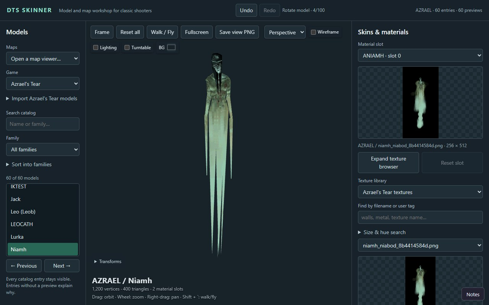
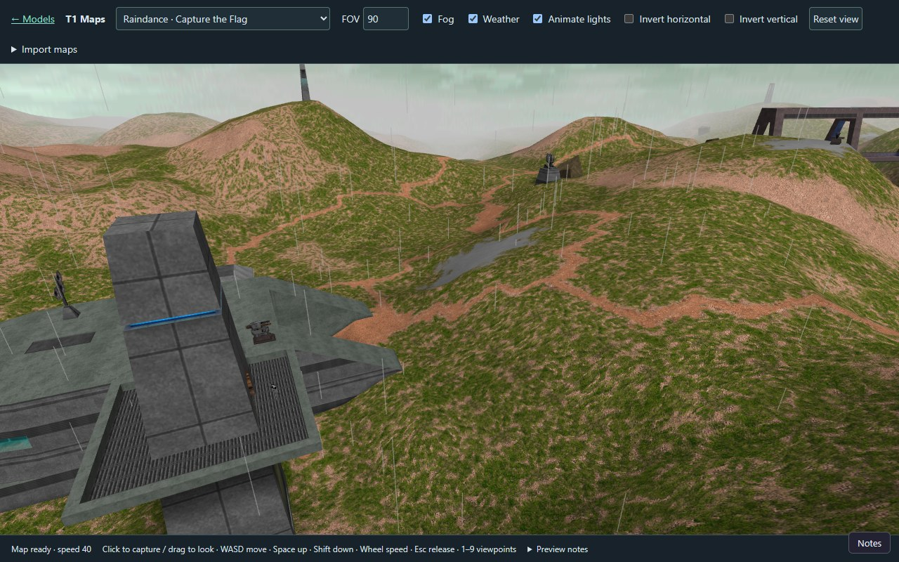
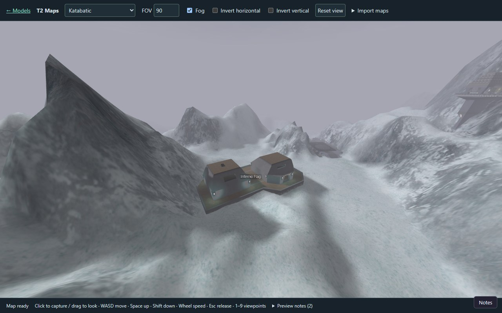
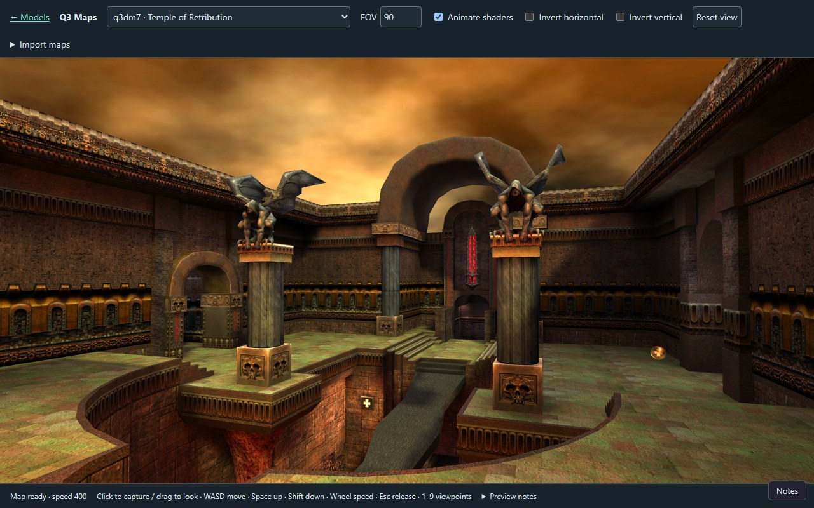
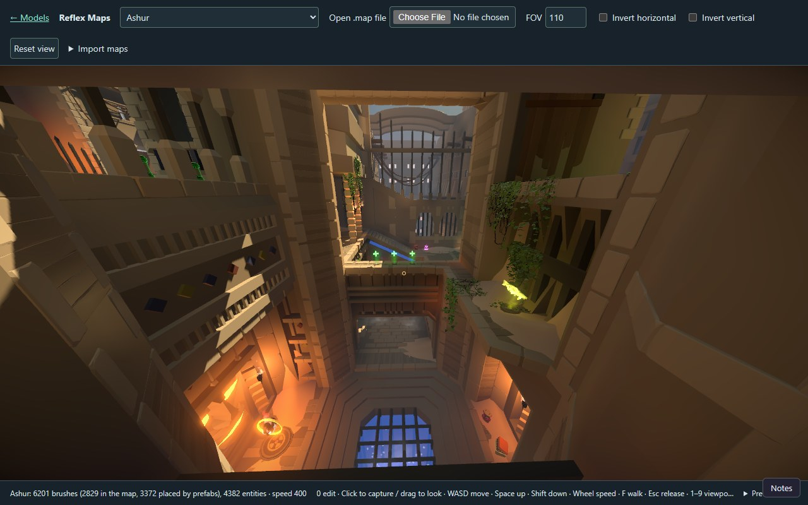
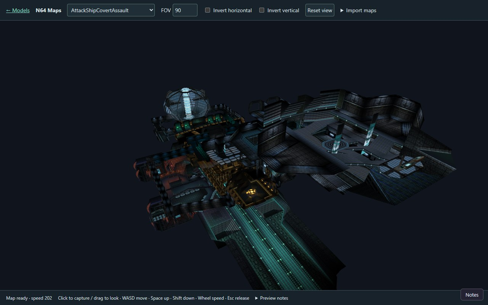
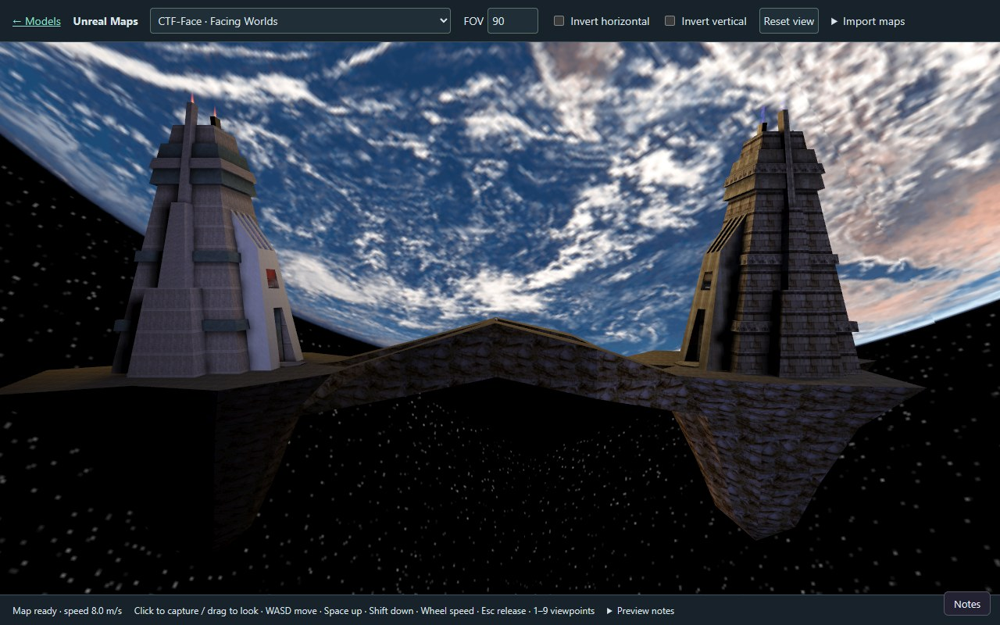
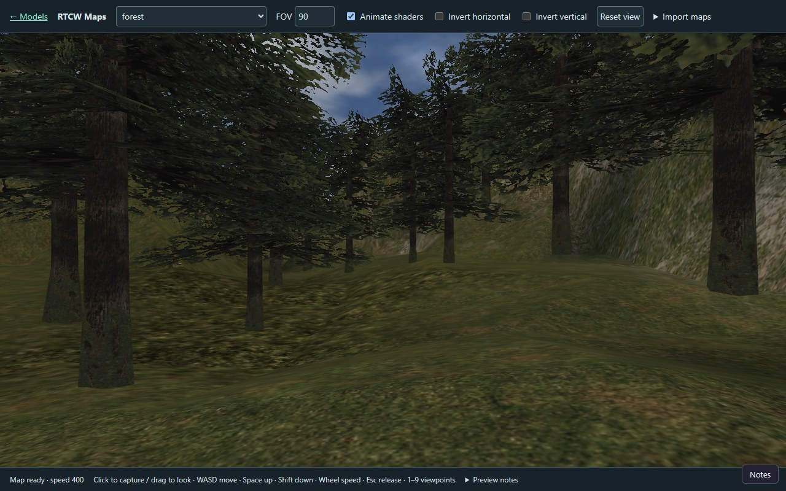
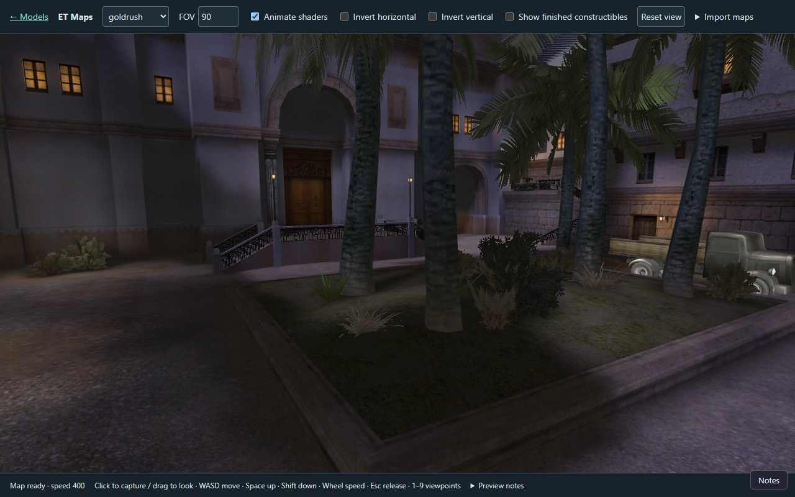
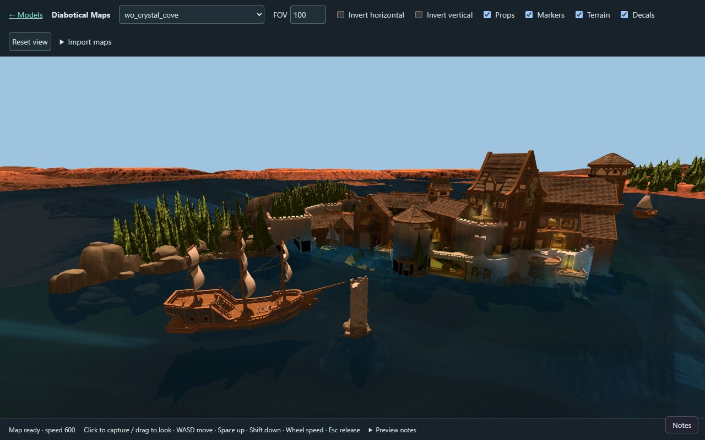

# DTS Skinner

Browse, reskin and export models from Tribes, Quake, Unreal, Wolfenstein and a dozen other classic shooters, and fly through their maps lit the way the games light them. Runs on Windows, with the 3D views in your browser.

**[Download the latest release](https://github.com/shadoh420/DTS_Skinner/releases/latest)**

## What it does

- **Models:** pick a game, import it from your own install, and swap any material's texture for one from any game's library. Export as GLB (with animations where the game has them) or OBJ.
- **Maps:** free-flight previews of each game's levels with their lightmaps, skies, placed props and pickups. Each page's **Preview notes** say what is not drawn.
- **Reflex editing:** walk Reflex Arena maps with Quake-style movement and edit their brushes with the game's editor keys, then save the `.map`.
- **Texture workshop:** a large gallery with your own tags, size and hue search, and rotate/flip copies.
- **Your own families and notes:** sort models into families per game, and keep a note on any model or map (`local-data/notes.json`, readable by scripts and agents). Tribes 1's catalog comes sorted the way the game's files group it (Armors, Weapons, InteriorShapes and so on).

Nothing is shipped from the games except the stock Tribes 1 and 2 content in the data ZIP: every other game is imported from your install with its page's **Import** box.

## Games

| Game | Models | Maps | Notes |
| --- | :---: | :---: | --- |
| Starsiege: Tribes | ✓ | ✓ | Stock models bundled; custom missions and their buildings too |
| Tribes 2 | ✓ | ✓ | Stock models bundled; IronSphere (T2RPG) see [T2_IMPORT.md](T2_IMPORT.md#ironsphere-t2rpg) |
| Tribes conversions and mods | ✓ | | TA and TV conversion packs, TRPG, Star Wars, RedMoon; GoldenEye 007 mod (below) |
| Starsiege, Earthsiege 1 and 2 | ✓ | | |
| Red Baron 3D | ✓ | ✓ | Maps are experimental, see [Red Baron 3D maps](docs/redbaron-maps.md) |
| Quake | ✓ | ✓ | Mission packs and the 2021 rerelease (enhanced models, extra episodes) |
| Quake II | ✓ | ✓ | The Reckoning, Ground Zero, CTF |
| Quake 3 Arena | ✓ | ✓ | Team Arena and custom pk3s, see [Q3 maps](docs/q3-map-viewer.md) |
| Return to Castle Wolfenstein | ✓ | ✓ | Single player and Multiplayer |
| Wolfenstein: Enemy Territory | ✓ | ✓ | Constructibles at map start, or finished |
| Vampire: The Masquerade - Bloodlines | ✓ | ✓ | Unofficial Patch over stock; static model poses, lightmapped maps with props and pickups, no NPCs |
| Jedi Outcast | ✓ | ✓ | Single player and Multiplayer maps, static Ghoul2 models |
| Jedi Academy | ✓ | ✓ | Stock Ghoul2 characters and parked vehicles; Single player and Multiplayer maps, including Siege |
| Unreal, Unreal Tournament | ✓ | ✓ | Unreal Gold / 227 and UT 469, see [Unreal maps](docs/unreal-map-viewer.md) |
| Deus Ex | ✓ | ✓ | Stock GOTY models with class skins; [maps](docs/unreal-map-viewer.md#deus-ex) with props and pickups, without NPCs |
| Daikatana, Anachronox, SiN | ✓ | ✓ | |
| Azrael's Tear | ✓ | ✓ | Models export with their animation clips |
| Diabotical | ✓ | ✓ | Editpad props and your own maps, see [Diabotical maps](docs/diabotical-map-viewer.md) |
| Reflex Arena | ✓ | ✓ | Brush editor, see [Reflex maps](docs/reflex-map-viewer.md) |
| N64 conversions | | ✓ | [L. Spiro](https://github.com/L-Spiro)'s GoldenEye, Perfect Dark, Diddy Kong Racing and more; bring your own copy |

Bloodlines models and maps share one texture library and keep DXT textures with their original mipmaps; model geometry is stored in indexed binary files. Texture downloads and edited copies are PNGs.

Deus Ex models and maps share their texture folder and store model geometry in binary files.

Tribes map details: [T1 maps](docs/t1-map-viewer.md), [T2 maps](docs/t2-map-viewer.md). Export details: [ANIMATION_EXPORT.md](ANIMATION_EXPORT.md).

**GoldenEye 007 (Tribes mod)** levels are not included; convert your copy with
`python tools/add_t1_buildings.py --game-base <Tribes folder> --mission "<mod>/Missions" --resources "<mod>/Base" --static <local-data>/ge --catalog ge`.

## Getting started

1. Download the release's app ZIP (`DTS-Skinner-vN-Windows.zip`) and, the first time, the data ZIP the release notes link (`DTS-Skinner-data-Windows.zip`, the stock Tribes models and textures). Extract both into the same folder. For later releases, extract only the new app ZIP over it, unless the notes say the data changed.
2. Run `SkinnerApp.exe` and keep `_internal` and `local-data` beside it. It opens in your browser (or visit `http://localhost:5000/`); quit from the tray icon.
3. Pick a game, import it if needed, choose a model and material, pick a texture and click **Apply to slot**.

Imports, tags, families and notes live in `%LOCALAPPDATA%\DTS-Skinner\local-data`, shared by every release.

The app is not code-signed, so SmartScreen may warn on first start ("More info", then "Run anyway"). Check the ZIP against the release's `.sha256` first (`certutil -hashfile <zip> SHA256`).

**Controls:** drag to orbit, wheel to zoom, right-drag to pan; **Walk / Fly** (Shift + backtick) uses WASD and Q/E. On map pages, click to look around, WASD to move, 1–9 for viewpoints. Ctrl+Z / Ctrl+Y undo and redo.

## Screenshots

| T1 Maps (Raindance) | T2 Maps (Katabatic) |
| --- | --- |
|  |  |
| **Q3 Maps (Temple of Retribution)** | **Reflex Maps (Ashur)** |
|  |  |
| **N64 Maps (Attack Ship, Perfect Dark)** | **Unreal Maps (CTF-Face)** |
|  |  |
| **RTCW Maps (Forest)** | **ET Maps (Gold Rush)** |
|  |  |
| **Diabotical Maps (Crystal Cove)** | |
|  | |

## Development

Jedi Academy models and maps share textures, keep unchanged JPG originals, and store mesh geometry in binary files.

Run the tests with `python -B -m unittest discover -s tests -v`; `tools/check_texture_workshop.cjs` and `tools/check_viewport_workshop.cjs` check the browser UI (Playwright). [RELEASING.md](RELEASING.md) is the release recipe.

## Credits and license

Built with Python and Three.js. Inspired by [exogen's T2 Model Skinner](https://github.com/exogen/t2-model-skinner). N64 map support follows [L. Spiro](https://github.com/L-Spiro)'s level conversions and Blender material rules, used with permission.

Skinner's own code is released under the [MIT License](LICENSE). The games' models and textures, the conversion packs and the vendored third-party code (see `static/t2-maps/THIRD-PARTY-NOTICES.txt`) keep their own owners and licences. The Tribes 1 and 2 content in the release is covered by [NOTICE.md](NOTICE.md).
